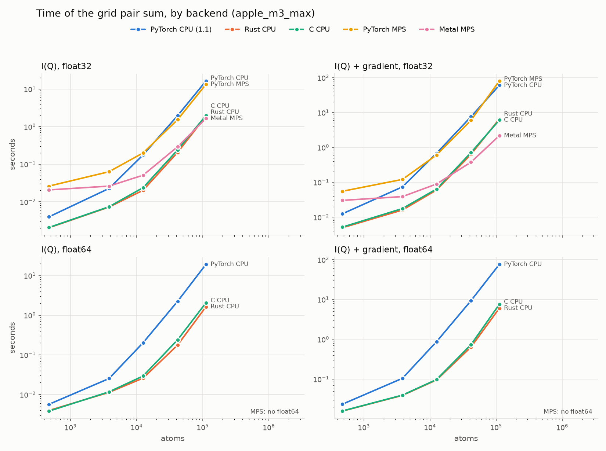
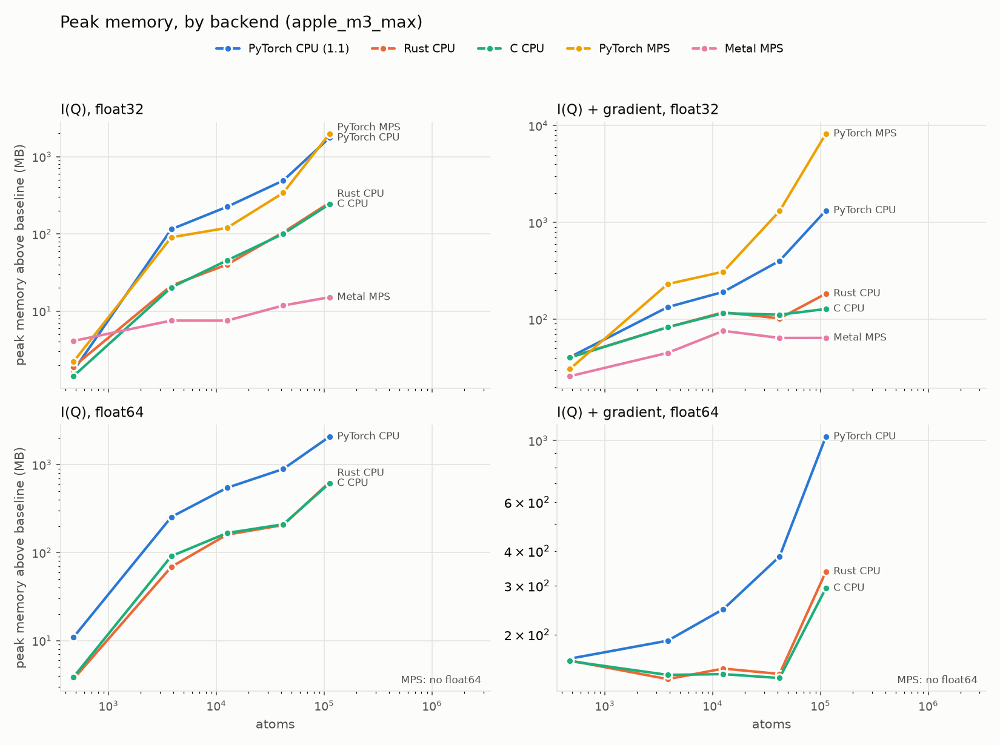
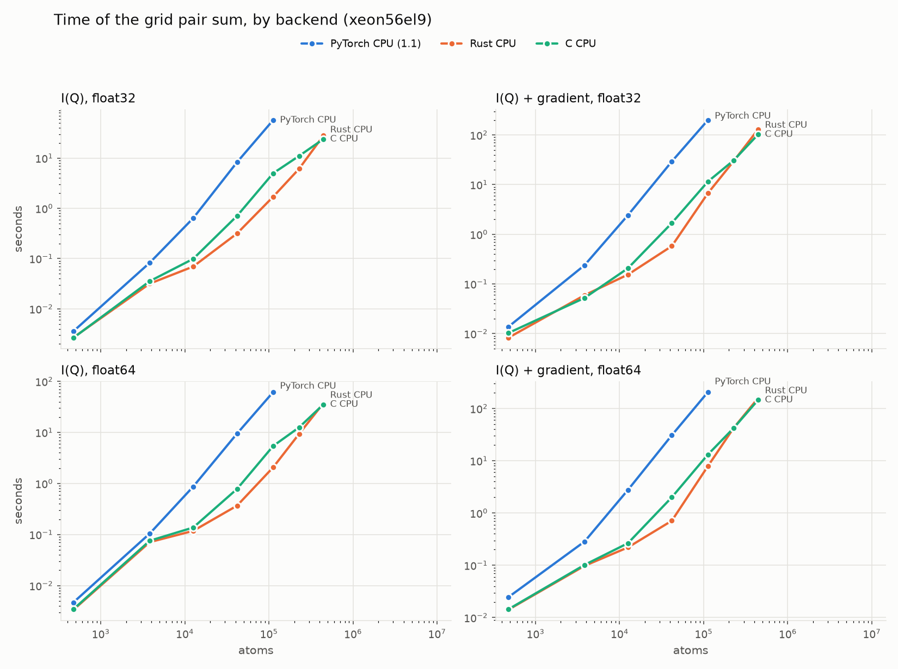
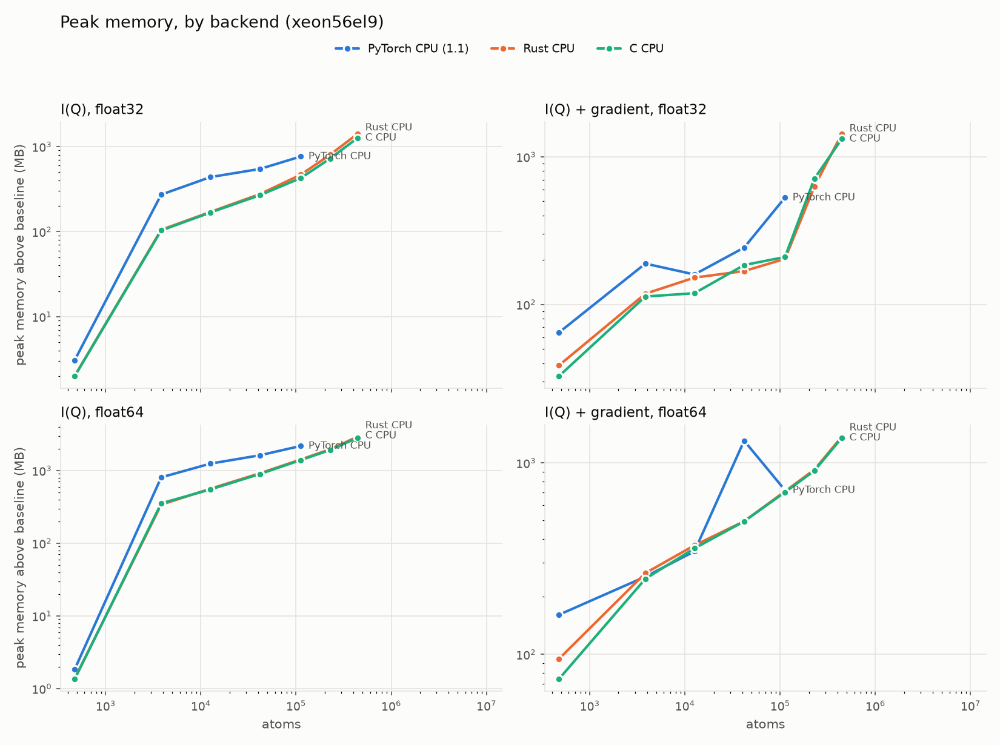
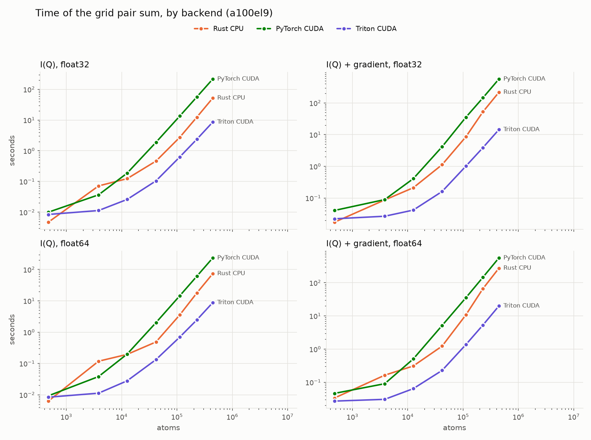
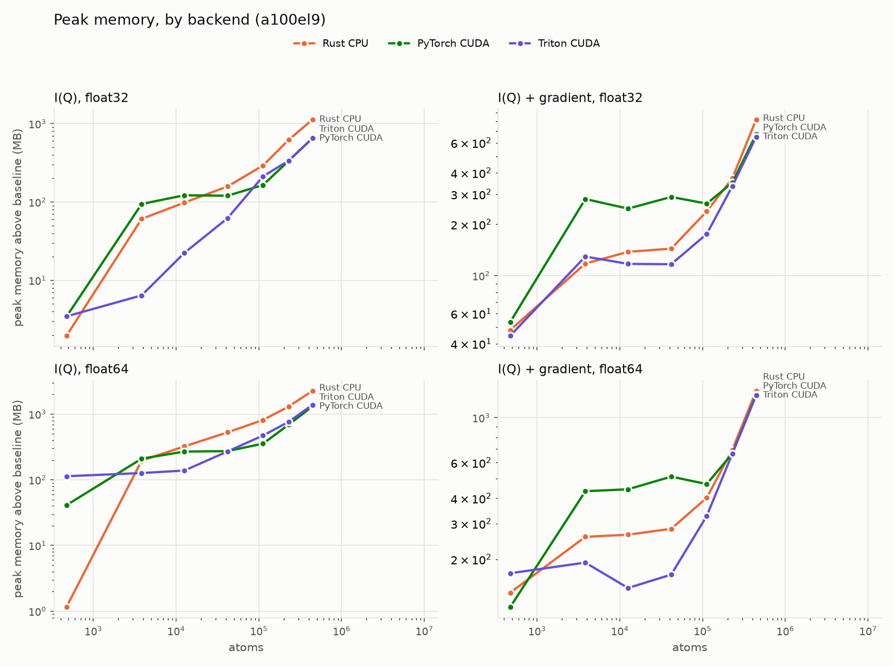
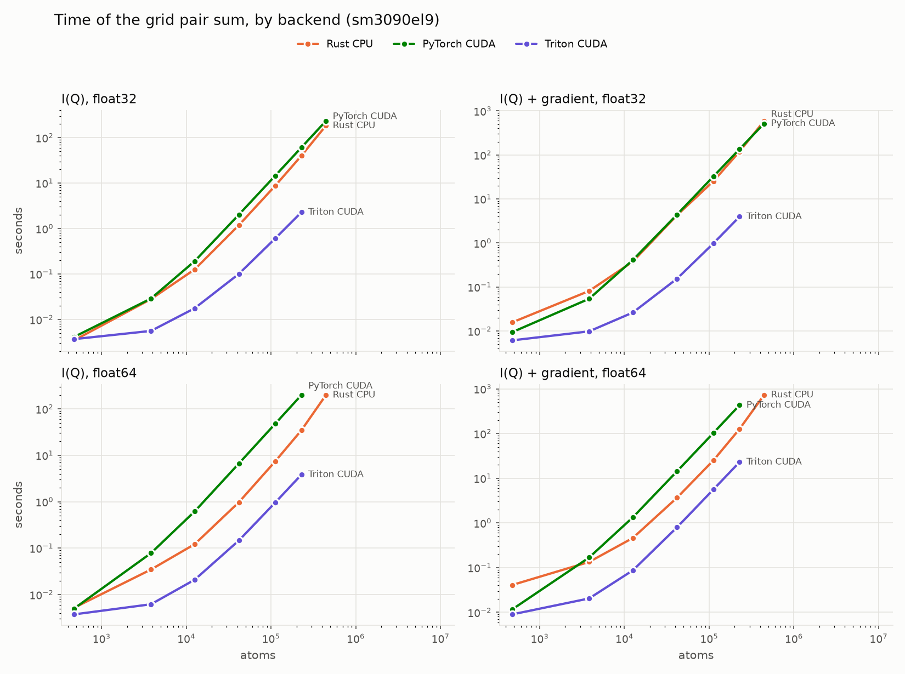
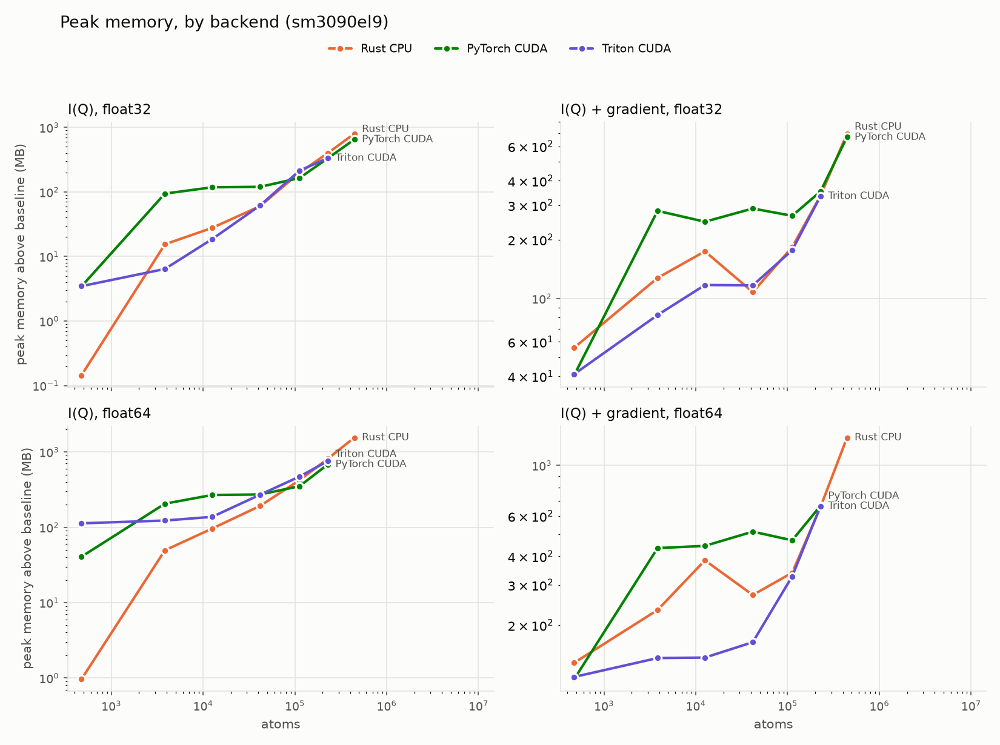

# Benchmark: grid pair sum backends

Today's code (PyTorch on CPU, MPS and CUDA) against the fused kernels of this branch: **Rust** on CPU, **Metal**
on Apple GPUs, **Triton** on NVIDIA GPUs. The C kernels that were benchmarked alongside Rust gave no advantage and
were removed; their results stay in the tables for reference.

**Machines.** Apple M3 Max (12 PyTorch threads, macOS); Niflheim (DTU): one whole `xeon56el9` node (Intel Xeon Gold
6348, 56 cores), one A100-SXM4-40GB (`a100el9`, 32 cores), one RTX 3090 (`sm3090el9`, 8 cores); PyTorch 2.14,
CUDA 12.6 wheels, Triton 3.8.

**Workload.** Spherical Co₂O (anti-fluorite) particles of radius 10, 20, 30, 45 and 63 Å (473 to 112,331 atoms),
on Niflheim also 80 and 100 Å (228,653 and 444,263 atoms) for the fast backends; Q from 1 to 30 Å⁻¹, default
settings otherwise. *I(Q)* is the forward calculation; *I(Q) + gradient* adds the gradient of a weighted sum of
I(Q) with respect to all positions.

**Method.** Each configuration runs in a fresh process after an untimed warm-up on a tiny particle (which pays
one-time costs such as CUDA start-up and kernel compilation). Time: fastest of up to 5 runs (at least 2). Memory:
peak resident RAM above the level before the run, sampled every millisecond, plus peak memory of live GPU tensors.
Accuracy: against the float64 result of the Rust kernels, which agrees with the float64 PyTorch code to ~1e-14.
Reproduce with `kernels/benchmark.py` and `kernels/benchmark_report.py`; Niflheim scripts in `hpc/niflheim/`.
Raw results: `kernels/benchmark_results/*.jsonl`.

**Not complete.** On the RTX 3090, PyTorch CUDA in float64 and Triton at 444,263 atoms were still running when this
was written (the RTX 3090 runs float64 at 1/64 of its float32 rate).

## Summary: I(Q) + gradient, today's code against the new backend on the same device

| machine | device | atoms | precision | today: time / memory | new: time / memory | speed-up | memory ratio |
|---|---|---:|---|---|---|---:|---:|
| Apple M3 Max | CPU (rust) | 12,581 | float32 | 678 ms / 192 MB | 60 ms / 118 MB | 11.3× | 1.6× |
| Apple M3 Max | CPU (rust) | 12,581 | float64 | 869 ms / 247 MB | 95 ms / 151 MB | 9.1× | 1.6× |
| Apple M3 Max | CPU (rust) | 112,331 | float32 | 60.6 s / 1329 MB | 6.5 s / 184 MB | 9.3× | 7.2× |
| Apple M3 Max | CPU (rust) | 112,331 | float64 | 76.4 s / 1033 MB | 6.0 s / 337 MB | 12.6× | 3.1× |
| Apple M3 Max | MPS (metal) | 12,581 | float32 | 607 ms / 310 MB | 89 ms / 76 MB | 6.8× | 4.1× |
| Apple M3 Max | MPS (metal) | 112,331 | float32 | 80.3 s / 8244 MB | 2.2 s / 64 MB | 36.9× | 128.2× |
| Xeon Gold 6348 (56 cores) | CPU (rust) | 12,581 | float32 | 2.4 s / 159 MB | 154 ms / 152 MB | 15.7× | 1.1× |
| Xeon Gold 6348 (56 cores) | CPU (rust) | 12,581 | float64 | 2.8 s / 345 MB | 220 ms / 371 MB | 12.6× | 0.9× |
| Xeon Gold 6348 (56 cores) | CPU (rust) | 112,331 | float32 | 199.3 s / 529 MB | 6.7 s / 203 MB | 29.7× | 2.6× |
| Xeon Gold 6348 (56 cores) | CPU (rust) | 112,331 | float64 | 206.0 s / 720 MB | 7.9 s / 710 MB | 26.1× | 1.0× |
| NVIDIA A100 | CUDA (triton) | 12,581 | float32 | 408 ms / 247 MB | 42 ms / 117 MB | 9.8× | 2.1× |
| NVIDIA A100 | CUDA (triton) | 12,581 | float64 | 505 ms / 443 MB | 64 ms / 144 MB | 7.9× | 3.1× |
| NVIDIA A100 | CUDA (triton) | 112,331 | float32 | 35.3 s / 264 MB | 1.0 s / 175 MB | 34.9× | 1.5× |
| NVIDIA A100 | CUDA (triton) | 112,331 | float64 | 35.3 s / 470 MB | 1.4 s / 327 MB | 25.9× | 1.4× |
| NVIDIA A100 | CUDA (triton) | 444,263 | float32 | 569.6 s / 672 MB | 14.4 s / 650 MB | 39.4× | 1.0× |
| NVIDIA A100 | CUDA (triton) | 444,263 | float64 | 561.8 s / 1294 MB | 20.0 s / 1291 MB | 28.1× | 1.0× |
| NVIDIA RTX 3090 | CUDA (triton) | 12,581 | float32 | 411 ms / 247 MB | 26 ms / 117 MB | 15.6× | 2.1× |
| NVIDIA RTX 3090 | CUDA (triton) | 12,581 | float64 | 1.3 s / 444 MB | 87 ms / 144 MB | 15.3× | 3.1× |
| NVIDIA RTX 3090 | CUDA (triton) | 112,331 | float32 | 32.4 s / 265 MB | 980 ms / 177 MB | 33.1× | 1.5× |
| NVIDIA RTX 3090 | CUDA (triton) | 112,331 | float64 | 103.0 s / 470 MB | 5.6 s / 327 MB | 18.4× | 1.4× |

- **Speed:** 7–16× at 12,581 atoms and 18–39× at 112,000–444,000 atoms, on every device and precision.
- **Memory:** today's code already bounds its working memory by the batch size, so the CPU and CUDA kernels save
  less memory than time (1–7×). On Apple GPUs the PyTorch MPS code needs up to 8 GB; Metal needs tens of MB.
- **Accuracy:** float64 agrees with the PyTorch code to ~1e-14 on every backend. In float32 the kernels have the same
  or smaller error than the PyTorch code (float64 accumulation); the PyTorch MPS code and Metal have ~1e-5 (MPS has
  no float64 for the node sums around the kernel).
- **Tests:** all tests pass on every machine and backend (103 on the GPU nodes, 70+ on CPU).

## Charts (one per machine)

| | time | memory |
|---|---|---|
| Apple M3 Max |  |  |
| Xeon Gold 6348 |  |  |
| A100 |  |  |
| RTX 3090 |  |  |

Per-machine tables with accuracy and GPU memory (tensors and driver): `benchmark_results/<machine>/tables.md`.

## All machines and backends

**Machines**

- **apple_m3_max**: Apple M3 Max, 12 threads, PyTorch 2.14.0
- **xeon56el9**: Intel(R) Xeon(R) Gold 6348 CPU @ 2.60GHz, 56 threads, PyTorch 2.14.1+cu126
- **a100el9**: Intel(R) Xeon(R) Platinum 8358 CPU @ 2.60GHz, 32 threads, NVIDIA A100-SXM4-40GB, PyTorch 2.14.1+cu126, CUDA 12.6, Triton 3.8.0
- **sm3090el9**: Intel(R) Xeon(R) Gold 5218R CPU @ 2.10GHz, 8 threads, NVIDIA GeForce RTX 3090, PyTorch 2.14.1+cu126, CUDA 12.6, Triton 3.8.0

**I(Q), float32**: time / peak memory (RAM + GPU tensors)

| machine | backend | 473 atoms | 3,833 atoms | 12,581 atoms | 41,801 atoms | 112,331 atoms | 228,653 atoms | 444,263 atoms |
|---|---|---:|---:|---:|---:|---:|---:|---:|
| apple_m3_max | PyTorch CPU (1.1) | 4.0 ms / 2 MB | 22.6 ms / 115 MB | 176.8 ms / 224 MB | 1.96 s / 491 MB | 16.37 s / 1760 MB | – | – |
| apple_m3_max | Rust CPU | 2.0 ms / 2 MB | 7.2 ms / 21 MB | 20.3 ms / 40 MB | 205.8 ms / 105 MB | 1.90 s / 254 MB | – | – |
| apple_m3_max | C CPU | 2.1 ms / 1 MB | 7.4 ms / 20 MB | 23.8 ms / 45 MB | 239.5 ms / 100 MB | 1.98 s / 243 MB | – | – |
| apple_m3_max | PyTorch MPS | 26.1 ms / 2 MB | 63.1 ms / 90 MB | 200.1 ms / 120 MB | 1.53 s / 340 MB | 13.34 s / 1982 MB | – | – |
| apple_m3_max | Metal MPS | 20.7 ms / 4 MB | 26.1 ms / 8 MB | 51.0 ms / 8 MB | 291.0 ms / 12 MB | 1.65 s / 15 MB | – | – |
| xeon56el9 | PyTorch CPU (1.1) | 3.6 ms / 3 MB | 82.9 ms / 273 MB | 637.9 ms / 438 MB | 8.30 s / 546 MB | 57.14 s / 766 MB | – | – |
| xeon56el9 | Rust CPU | 2.7 ms / 2 MB | 31.8 ms / 105 MB | 69.4 ms / 170 MB | 316.3 ms / 277 MB | 1.70 s / 468 MB | 6.13 s / 805 MB | 27.98 s / 1416 MB |
| xeon56el9 | C CPU | 2.6 ms / 2 MB | 35.6 ms / 103 MB | 98.8 ms / 168 MB | 707.7 ms / 268 MB | 5.00 s / 427 MB | 11.06 s / 726 MB | 23.94 s / 1266 MB |
| a100el9 | Rust CPU | 4.7 ms / 2 MB | 71.7 ms / 61 MB | 123.4 ms / 98 MB | 461.4 ms / 158 MB | 2.74 s / 292 MB | 12.40 s / 620 MB | 52.15 s / 1129 MB |
| a100el9 | PyTorch CUDA | 10.0 ms / 3 MB | 36.7 ms / 94 MB | 187.0 ms / 122 MB | 1.89 s / 120 MB | 13.47 s / 165 MB | 56.52 s / 335 MB | 217.03 s / 651 MB |
| a100el9 | Triton CUDA | 8.4 ms / 3 MB | 11.3 ms / 6 MB | 26.0 ms / 22 MB | 104.6 ms / 62 MB | 628.5 ms / 213 MB | 2.37 s / 337 MB | 8.61 s / 655 MB |
| sm3090el9 | Rust CPU | 3.5 ms / 0 MB | 28.0 ms / 15 MB | 126.4 ms / 28 MB | 1.19 s / 60 MB | 8.76 s / 199 MB | 40.08 s / 400 MB | 182.66 s / 799 MB |
| sm3090el9 | PyTorch CUDA | 4.1 ms / 3 MB | 28.8 ms / 94 MB | 191.9 ms / 118 MB | 2.03 s / 120 MB | 14.58 s / 165 MB | 60.83 s / 333 MB | 232.34 s / 651 MB |
| sm3090el9 | Triton CUDA | 3.7 ms / 3 MB | 5.6 ms / 6 MB | 17.6 ms / 19 MB | 100.7 ms / 62 MB | 606.7 ms / 214 MB | 2.28 s / 335 MB | – |

**I(Q) + gradient, float32**: time / peak memory (RAM + GPU tensors)

| machine | backend | 473 atoms | 3,833 atoms | 12,581 atoms | 41,801 atoms | 112,331 atoms | 228,653 atoms | 444,263 atoms |
|---|---|---:|---:|---:|---:|---:|---:|---:|
| apple_m3_max | PyTorch CPU (1.1) | 12.4 ms / 41 MB | 73.7 ms / 134 MB | 677.6 ms / 192 MB | 7.59 s / 402 MB | 60.60 s / 1329 MB | – | – |
| apple_m3_max | Rust CPU | 5.0 ms / 41 MB | 16.0 ms / 83 MB | 59.8 ms / 118 MB | 631.6 ms / 102 MB | 6.54 s / 184 MB | – | – |
| apple_m3_max | C CPU | 5.2 ms / 40 MB | 17.6 ms / 83 MB | 63.9 ms / 116 MB | 710.2 ms / 112 MB | 6.07 s / 128 MB | – | – |
| apple_m3_max | PyTorch MPS | 55.2 ms / 31 MB | 120.6 ms / 231 MB | 606.6 ms / 310 MB | 5.99 s / 1311 MB | 80.29 s / 8244 MB | – | – |
| apple_m3_max | Metal MPS | 30.2 ms / 26 MB | 38.8 ms / 45 MB | 89.0 ms / 76 MB | 376.8 ms / 64 MB | 2.17 s / 64 MB | – | – |
| xeon56el9 | PyTorch CPU (1.1) | 13.6 ms / 64 MB | 238.7 ms / 189 MB | 2.43 s / 159 MB | 29.24 s / 242 MB | 199.25 s / 529 MB | – | – |
| xeon56el9 | Rust CPU | 8.2 ms / 39 MB | 59.4 ms / 118 MB | 154.4 ms / 152 MB | 578.8 ms / 168 MB | 6.71 s / 203 MB | 30.08 s / 627 MB | 129.53 s / 1432 MB |
| xeon56el9 | C CPU | 10.2 ms / 33 MB | 52.3 ms / 113 MB | 207.1 ms / 119 MB | 1.68 s / 185 MB | 11.52 s / 209 MB | 31.07 s / 712 MB | 102.54 s / 1322 MB |
| a100el9 | Rust CPU | 17.3 ms / 48 MB | 87.0 ms / 118 MB | 211.1 ms / 138 MB | 1.13 s / 144 MB | 8.54 s / 238 MB | 52.61 s / 371 MB | 217.43 s / 820 MB |
| a100el9 | PyTorch CUDA | 40.5 ms / 53 MB | 89.4 ms / 281 MB | 407.8 ms / 247 MB | 4.16 s / 289 MB | 35.33 s / 264 MB | 145.54 s / 350 MB | 569.56 s / 672 MB |
| a100el9 | Triton CUDA | 22.1 ms / 44 MB | 26.7 ms / 129 MB | 41.6 ms / 117 MB | 161.0 ms / 117 MB | 1.01 s / 175 MB | 3.90 s / 334 MB | 14.45 s / 650 MB |
| sm3090el9 | Rust CPU | 15.7 ms / 56 MB | 81.3 ms / 127 MB | 377.5 ms / 174 MB | 4.28 s / 108 MB | 25.35 s / 183 MB | 119.42 s / 336 MB | 589.32 s / 696 MB |
| sm3090el9 | PyTorch CUDA | 9.4 ms / 41 MB | 54.0 ms / 281 MB | 411.2 ms / 247 MB | 4.43 s / 288 MB | 32.45 s / 265 MB | 135.62 s / 353 MB | 514.56 s / 669 MB |
| sm3090el9 | Triton CUDA | 6.1 ms / 41 MB | 9.8 ms / 82 MB | 26.3 ms / 117 MB | 154.6 ms / 117 MB | 980.3 ms / 177 MB | 3.97 s / 334 MB | – |

**I(Q), float64**: time / peak memory (RAM + GPU tensors)

| machine | backend | 473 atoms | 3,833 atoms | 12,581 atoms | 41,801 atoms | 112,331 atoms | 228,653 atoms | 444,263 atoms |
|---|---|---:|---:|---:|---:|---:|---:|---:|
| apple_m3_max | PyTorch CPU (1.1) | 5.7 ms / 11 MB | 25.3 ms / 254 MB | 203.1 ms / 544 MB | 2.24 s / 891 MB | 19.20 s / 2076 MB | – | – |
| apple_m3_max | Rust CPU | 4.0 ms / 4 MB | 11.4 ms / 69 MB | 25.9 ms / 160 MB | 177.0 ms / 206 MB | 1.63 s / 633 MB | – | – |
| apple_m3_max | C CPU | 3.8 ms / 4 MB | 11.7 ms / 91 MB | 29.3 ms / 167 MB | 239.6 ms / 210 MB | 2.06 s / 613 MB | – | – |
| xeon56el9 | PyTorch CPU (1.1) | 4.7 ms / 2 MB | 104.9 ms / 806 MB | 868.9 ms / 1245 MB | 9.49 s / 1623 MB | 61.61 s / 2182 MB | – | – |
| xeon56el9 | Rust CPU | 3.4 ms / 1 MB | 71.1 ms / 339 MB | 118.0 ms / 562 MB | 367.5 ms / 918 MB | 2.07 s / 1421 MB | 9.34 s / 1966 MB | 37.15 s / 2927 MB |
| xeon56el9 | C CPU | 3.5 ms / 1 MB | 75.7 ms / 354 MB | 137.2 ms / 549 MB | 781.2 ms / 897 MB | 5.42 s / 1395 MB | 12.55 s / 1918 MB | 35.32 s / 2827 MB |
| a100el9 | Rust CPU | 6.3 ms / 1 MB | 118.3 ms / 196 MB | 195.3 ms / 322 MB | 486.8 ms / 527 MB | 3.56 s / 814 MB | 17.83 s / 1301 MB | 73.96 s / 2255 MB |
| a100el9 | PyTorch CUDA | 9.3 ms / 41 MB | 38.3 ms / 209 MB | 199.8 ms / 269 MB | 2.02 s / 273 MB | 14.50 s / 355 MB | 61.04 s / 689 MB | 235.20 s / 1310 MB |
| a100el9 | Triton CUDA | 8.4 ms / 113 MB | 11.3 ms / 127 MB | 28.0 ms / 138 MB | 133.2 ms / 270 MB | 697.2 ms / 472 MB | 2.46 s / 761 MB | 8.81 s / 1384 MB |
| sm3090el9 | Rust CPU | 5.2 ms / 1 MB | 34.6 ms / 49 MB | 121.8 ms / 96 MB | 975.6 ms / 192 MB | 7.42 s / 422 MB | 34.66 s / 813 MB | 197.45 s / 1550 MB |
| sm3090el9 | PyTorch CUDA | 5.0 ms / 41 MB | 78.0 ms / 206 MB | 619.7 ms / 268 MB | 6.66 s / 273 MB | 47.98 s / 351 MB | 198.67 s / 684 MB | – |
| sm3090el9 | Triton CUDA | 3.7 ms / 113 MB | 6.2 ms / 123 MB | 20.9 ms / 138 MB | 146.4 ms / 271 MB | 962.2 ms / 471 MB | 3.83 s / 757 MB | – |

**I(Q) + gradient, float64**: time / peak memory (RAM + GPU tensors)

| machine | backend | 473 atoms | 3,833 atoms | 12,581 atoms | 41,801 atoms | 112,331 atoms | 228,653 atoms | 444,263 atoms |
|---|---|---:|---:|---:|---:|---:|---:|---:|
| apple_m3_max | PyTorch CPU (1.1) | 23.4 ms / 164 MB | 104.5 ms / 190 MB | 869.4 ms / 247 MB | 9.34 s / 382 MB | 76.37 s / 1033 MB | – | – |
| apple_m3_max | Rust CPU | 15.7 ms / 161 MB | 38.9 ms / 138 MB | 95.0 ms / 151 MB | 636.9 ms / 144 MB | 6.04 s / 337 MB | – | – |
| apple_m3_max | C CPU | 15.8 ms / 160 MB | 39.6 ms / 143 MB | 97.5 ms / 144 MB | 732.7 ms / 139 MB | 7.56 s / 294 MB | – | – |
| xeon56el9 | PyTorch CPU (1.1) | 24.4 ms / 161 MB | 284.9 ms / 254 MB | 2.77 s / 345 MB | 30.78 s / 1306 MB | 206.02 s / 720 MB | – | – |
| xeon56el9 | Rust CPU | 14.1 ms / 95 MB | 97.8 ms / 265 MB | 220.2 ms / 371 MB | 711.4 ms / 495 MB | 7.89 s / 710 MB | 42.98 s / 922 MB | 158.37 s / 1371 MB |
| xeon56el9 | C CPU | 14.3 ms / 74 MB | 101.9 ms / 248 MB | 265.0 ms / 358 MB | 2.00 s / 495 MB | 13.16 s / 703 MB | 42.62 s / 909 MB | 145.69 s / 1352 MB |
| a100el9 | Rust CPU | 33.5 ms / 137 MB | 163.3 ms / 258 MB | 309.7 ms / 264 MB | 1.23 s / 283 MB | 10.75 s / 402 MB | 66.49 s / 694 MB | 275.42 s / 1356 MB |
| a100el9 | PyTorch CUDA | 46.2 ms / 116 MB | 90.5 ms / 433 MB | 504.8 ms / 443 MB | 5.16 s / 511 MB | 35.31 s / 470 MB | 146.64 s / 665 MB | 561.83 s / 1294 MB |
| a100el9 | Triton CUDA | 27.1 ms / 171 MB | 30.6 ms / 193 MB | 64.2 ms / 144 MB | 227.9 ms / 168 MB | 1.37 s / 327 MB | 5.32 s / 663 MB | 20.01 s / 1291 MB |
| sm3090el9 | Rust CPU | 40.8 ms / 137 MB | 134.0 ms / 233 MB | 460.6 ms / 384 MB | 3.67 s / 271 MB | 25.09 s / 339 MB | 126.54 s / 658 MB | 725.18 s / 1322 MB |
| sm3090el9 | PyTorch CUDA | 11.6 ms / 116 MB | 168.3 ms / 434 MB | 1.33 s / 444 MB | 14.29 s / 513 MB | 102.97 s / 470 MB | 430.56 s / 666 MB | – |
| sm3090el9 | Triton CUDA | 9.0 ms / 119 MB | 20.5 ms / 143 MB | 87.0 ms / 144 MB | 799.0 ms / 168 MB | 5.61 s / 327 MB | 22.97 s / 663 MB | – |
