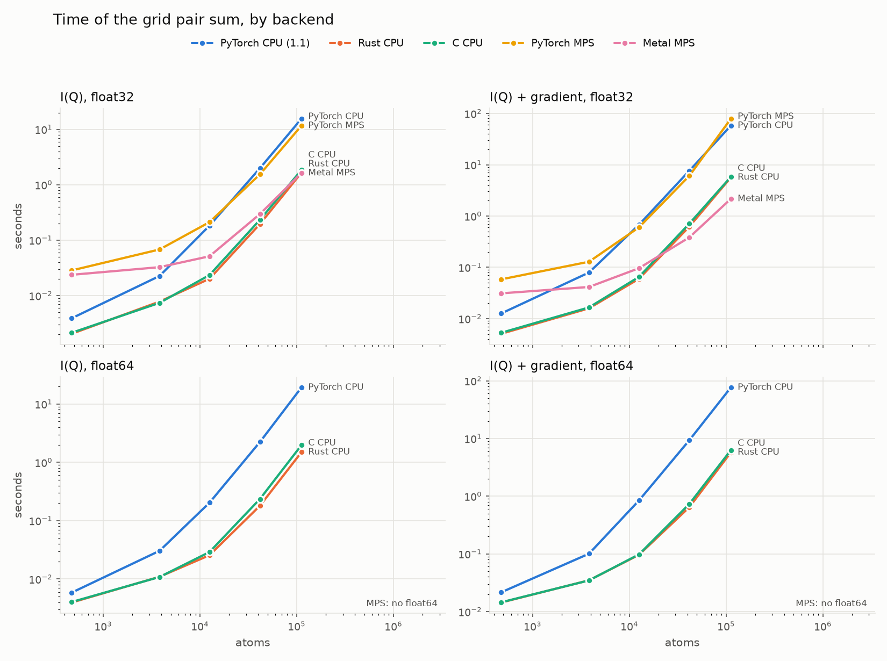
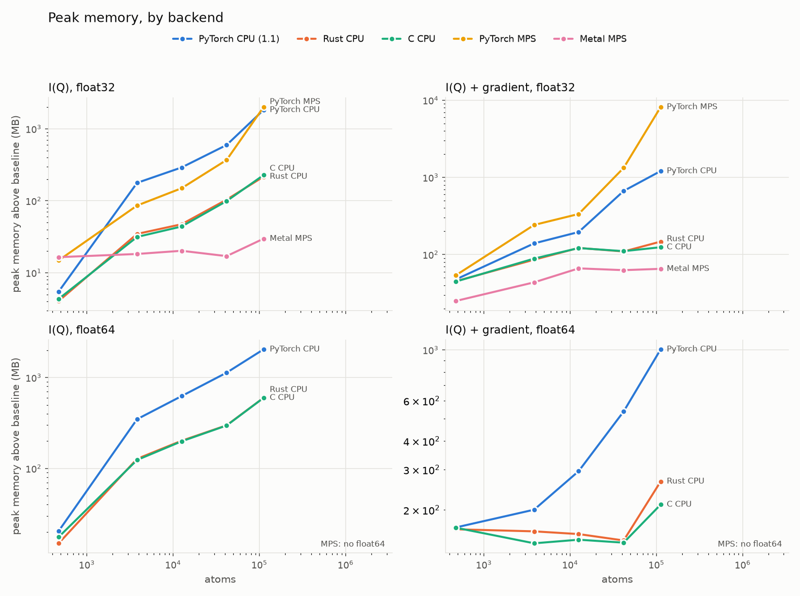

# Benchmark: grid pair sum backends

Machine: Apple M3 Max (12 performance + 4 efficiency cores; 12 PyTorch threads), macOS, Python 3.11.8,
PyTorch 2.14.0. Structures: spherical Co₂O (anti-fluorite) particles of radius 10, 20, 30, 45 and 63 Å
from `debyecalculator/data/AntiFluorite_Co2O.cif`; Q from 1 to 30 Å⁻¹; default settings otherwise.

- **Time**: fastest of up to 5 runs (at least 2), synchronised for MPS.
- **Memory**: peak above the level just before the run, sampled every millisecond in a fresh process per
  configuration: resident RAM plus, on MPS, memory held by live GPU tensors. The MPS driver figure (which includes the
  allocator's cached heaps) is in the GPU memory table.
- **I(Q) + gradient**: I(Q) and the gradient of a weighted sum of I(Q) with respect to all atomic positions.
- **Accuracy**: relative to the float64 result of the Rust kernels, which agrees with the float64 PyTorch code to
  ~1e-14 (shown in the accuracy table).

Reproduce with `python kernels/benchmark.py --out results.jsonl` and
`python kernels/benchmark_report.py results.jsonl --out-dir <dir>`; the raw results are in
[benchmark_results/apple_m3_max.jsonl](benchmark_results/apple_m3_max.jsonl).

## Summary

- **CPU, Rust and C kernels**: 7–15× faster than the PyTorch CPU code for 12,000 atoms and more, in float32 and float64,
  for I(Q) and for I(Q) with gradients; 1.5–5× for small particles. Peak memory is 2–8× lower. Rust is 3–30% faster
  than C at 40,000 atoms and more (same algorithm; the difference is code generation) and equal for small particles.
- **Apple GPU, Metal kernels**: 5–7× faster than the PyTorch MPS code for I(Q) and 16–36× for I(Q) with gradients
  above 40,000 atoms, with 20–125× less memory (tens of MB instead of GB). For I(Q) alone the M3 Max GPU is as fast as
  the Rust kernels on the CPU (atomic adds limit it); with gradients it is 1.6–2.6× faster than Rust above 40,000
  atoms. Below ~15,000 atoms the GPU launch overhead makes the CPU kernels faster.
- **PyTorch MPS** is at most 1.3× faster than the PyTorch CPU code (slower with gradients at 112,000 atoms), uses up
  to 8 GB of GPU memory, and is 5–20× less accurate than CPU float32 (it accumulates in float32). The Metal kernels
  have the accuracy of the PyTorch MPS code: the node sums around them still run in float32 on MPS.
- **Accuracy**: float64 kernels agree with the PyTorch code to ~1e-14. In float32 the CPU kernels have the same or
  smaller error than the PyTorch CPU code.

## What to expect on NVIDIA GPUs (not measured)

On CUDA, DebyeCalculator uses the PyTorch code unchanged. It has the same structure as the MPS path, so expect the
same pattern: limited by memory traffic for batch-sized temporaries, GB-scale memory, and gains below what the GPU can
do. A fused CUDA (or Triton) kernel with the design of the Metal kernels would be the equivalent of this work:

- The forward pass is limited by atomic adds into the histogram. NVIDIA GPUs execute global atomics in L2 at much
  higher rates than Apple GPUs (and have native float64 atomics from compute capability 6.0), so a fused forward
  pass should run at several times the 3–4·10⁹ pairs/s of the M3 Max, roughly 10⁹ ·(10–30) pairs/s on an A100/H100 or
  RTX 4090: I(Q) of 112,000 atoms (6.3·10⁹ pairs) in a few hundred ms. The fused computation without atomics runs at
  7·10¹⁰ pairs/s on the M3 Max GPU; NVIDIA data-centre GPUs have 3–5× its float32 throughput.
- The backward pass needs no per-pair atomics and should scale with float32 throughput.
- float64: data-centre GPUs (A100, H100) run float64 at half the float32 rate, so float64 is practical there;
  consumer GPUs (RTX) run float64 at 1/64 of float32, where float64 would be slower than the Rust kernels on a
  workstation CPU. The float64 histogram accumulation itself is cheap on any recent NVIDIA GPU (native atomics).
- Memory: like the Metal kernels, tens of MB instead of GB.

## Results

**I(Q), float32**: time (speed-up vs PyTorch CPU) / peak memory (RAM + GPU tensors)

| atoms | PyTorch CPU (1.1) | Rust CPU | C CPU | PyTorch MPS | Metal MPS |
|---:|---:|---:|---:|---:|---:|
| 473 | 3.9 ms / 6 MB | 2.0 ms (1.9×) / 4 MB | 2.1 ms (1.8×) / 4 MB | 28.4 ms (0.1×) / 15 MB | 23.7 ms (0.2×) / 17 MB |
| 3,833 | 22.6 ms / 178 MB | 7.8 ms (2.9×) / 35 MB | 7.4 ms (3.1×) / 32 MB | 67.9 ms (0.3×) / 86 MB | 32.5 ms (0.7×) / 18 MB |
| 12,581 | 182.7 ms / 291 MB | 20.1 ms (9.1×) / 47 MB | 23.4 ms (7.8×) / 44 MB | 211.4 ms (0.9×) / 150 MB | 51.1 ms (3.6×) / 20 MB |
| 41,801 | 1.99 s / 596 MB | 195.6 ms (10.2×) / 104 MB | 232.6 ms (8.5×) / 99 MB | 1.54 s (1.3×) / 369 MB | 296.1 ms (6.7×) / 17 MB |
| 112,331 | 15.57 s / 1832 MB | 1.65 s (9.4×) / 217 MB | 1.85 s (8.4×) / 228 MB | 11.65 s (1.3×) / 2007 MB | 1.63 s (9.5×) / 30 MB |

**I(Q) + gradient, float32**: time (speed-up vs PyTorch CPU) / peak memory (RAM + GPU tensors)

| atoms | PyTorch CPU (1.1) | Rust CPU | C CPU | PyTorch MPS | Metal MPS |
|---:|---:|---:|---:|---:|---:|
| 473 | 12.6 ms / 48 MB | 5.1 ms (2.5×) / 45 MB | 5.3 ms (2.4×) / 45 MB | 58.2 ms (0.2×) / 54 MB | 31.1 ms (0.4×) / 25 MB |
| 3,833 | 79.2 ms / 140 MB | 15.9 ms (5.0×) / 86 MB | 16.5 ms (4.8×) / 89 MB | 128.5 ms (0.6×) / 242 MB | 41.4 ms (1.9×) / 44 MB |
| 12,581 | 675.2 ms / 196 MB | 59.7 ms (11.3×) / 122 MB | 64.9 ms (10.4×) / 121 MB | 600.8 ms (1.1×) / 336 MB | 96.0 ms (7.0×) / 66 MB |
| 41,801 | 7.65 s / 667 MB | 623.7 ms (12.3×) / 110 MB | 712.3 ms (10.7×) / 111 MB | 6.09 s (1.3×) / 1329 MB | 384.5 ms (19.9×) / 63 MB |
| 112,331 | 58.01 s / 1210 MB | 5.66 s (10.3×) / 147 MB | 5.81 s (10.0×) / 124 MB | 79.08 s (0.7×) / 8182 MB | 2.17 s (26.7×) / 65 MB |

**I(Q), float64**: time (speed-up vs PyTorch CPU) / peak memory (RAM + GPU tensors)

| atoms | PyTorch CPU (1.1) | Rust CPU | C CPU |
|---:|---:|---:|---:|
| 473 | 5.8 ms / 21 MB | 3.9 ms (1.5×) / 15 MB | 4.0 ms (1.4×) / 18 MB |
| 3,833 | 30.4 ms / 348 MB | 10.9 ms (2.8×) / 128 MB | 10.8 ms (2.8×) / 124 MB |
| 12,581 | 203.3 ms / 625 MB | 25.6 ms (8.0×) / 202 MB | 29.0 ms (7.0×) / 199 MB |
| 41,801 | 2.23 s / 1132 MB | 180.2 ms (12.4×) / 298 MB | 235.5 ms (9.5×) / 297 MB |
| 112,331 | 19.26 s / 2046 MB | 1.50 s (12.9×) / 600 MB | 1.97 s (9.8×) / 599 MB |

**I(Q) + gradient, float64**: time (speed-up vs PyTorch CPU) / peak memory (RAM + GPU tensors)

| atoms | PyTorch CPU (1.1) | Rust CPU | C CPU |
|---:|---:|---:|---:|
| 473 | 21.5 ms / 168 MB | 14.3 ms (1.5×) / 165 MB | 14.5 ms (1.5×) / 167 MB |
| 3,833 | 100.6 ms / 200 MB | 34.8 ms (2.9×) / 161 MB | 34.7 ms (2.9×) / 143 MB |
| 12,581 | 840.6 ms / 295 MB | 96.1 ms (8.7×) / 157 MB | 97.8 ms (8.6×) / 148 MB |
| 41,801 | 9.35 s / 538 MB | 646.6 ms (14.5×) / 147 MB | 734.0 ms (12.7×) / 144 MB |
| 112,331 | 76.73 s / 1006 MB | 5.75 s (13.3×) / 266 MB | 6.29 s (12.2×) / 211 MB |

**GPU memory** (peak above the level before the run; the driver figure includes the allocator's cached heaps)

| atoms | backend | I(Q): GPU tensors / GPU driver | I(Q) + gradient: GPU tensors / GPU driver |
|---:|---|---:|---:|
| 473 | PyTorch MPS | 2 MB / 40 MB | 21 MB / 48 MB |
| 473 | Metal MPS | 1 MB / 0 MB | 21 MB / 32 MB |
| 3,833 | PyTorch MPS | 72 MB / 1024 MB | 210 MB / 1024 MB |
| 3,833 | Metal MPS | 3 MB / 33 MB | 40 MB / 64 MB |
| 12,581 | PyTorch MPS | 113 MB / 2056 MB | 232 MB / 2088 MB |
| 12,581 | Metal MPS | 4 MB / 34 MB | 58 MB / 1056 MB |
| 41,801 | PyTorch MPS | 102 MB / 3248 MB | 251 MB / 3705 MB |
| 41,801 | Metal MPS | 6 MB / 1056 MB | 59 MB / 1056 MB |
| 112,331 | PyTorch MPS | 131 MB / 4128 MB | 241 MB / 8393 MB |
| 112,331 | Metal MPS | 9 MB / 1024 MB | 61 MB / 1032 MB |

**Accuracy** (relative to the float64 reference)

| atoms | backend | dtype | I(Q) max. rel. error | gradient rel. error |
|---:|---|---|---:|---:|
| 473 | PyTorch CPU (1.1) | float32 | 5.3e-07 | 2.3e-06 |
| 473 | PyTorch CPU (1.1) | float64 | 0.0e+00 | 5.6e-15 |
| 473 | Rust CPU | float32 | 5.3e-07 | 5.8e-07 |
| 473 | Rust CPU | float64 | 0.0e+00 | 0.0e+00 |
| 473 | C CPU | float32 | 5.3e-07 | 5.8e-07 |
| 473 | C CPU | float64 | 0.0e+00 | 0.0e+00 |
| 473 | PyTorch MPS | float32 | 1.3e-06 | 2.6e-06 |
| 473 | Metal MPS | float32 | 1.3e-06 | 2.3e-06 |
| 3,833 | PyTorch CPU (1.1) | float32 | 4.9e-07 | 1.5e-05 |
| 3,833 | PyTorch CPU (1.1) | float64 | 7.9e-16 | 2.7e-14 |
| 3,833 | Rust CPU | float32 | 4.9e-07 | 4.1e-06 |
| 3,833 | Rust CPU | float64 | 0.0e+00 | 0.0e+00 |
| 3,833 | C CPU | float32 | 4.9e-07 | 4.1e-06 |
| 3,833 | C CPU | float64 | 0.0e+00 | 0.0e+00 |
| 3,833 | PyTorch MPS | float32 | 4.9e-06 | 4.0e-05 |
| 3,833 | Metal MPS | float32 | 4.9e-06 | 4.0e-05 |
| 12,581 | PyTorch CPU (1.1) | float32 | 7.3e-07 | 4.6e-05 |
| 12,581 | PyTorch CPU (1.1) | float64 | 5.7e-16 | 1.3e-14 |
| 12,581 | Rust CPU | float32 | 7.3e-07 | 4.5e-05 |
| 12,581 | Rust CPU | float64 | 0.0e+00 | 0.0e+00 |
| 12,581 | C CPU | float32 | 7.3e-07 | 4.5e-05 |
| 12,581 | C CPU | float64 | 0.0e+00 | 0.0e+00 |
| 12,581 | PyTorch MPS | float32 | 1.3e-05 | 1.3e-05 |
| 12,581 | Metal MPS | float32 | 1.2e-05 | 1.3e-05 |
| 41,801 | PyTorch CPU (1.1) | float32 | 1.8e-06 | 4.6e-05 |
| 41,801 | PyTorch CPU (1.1) | float64 | 1.9e-15 | 2.2e-14 |
| 41,801 | Rust CPU | float32 | 1.8e-06 | 4.3e-05 |
| 41,801 | Rust CPU | float64 | 0.0e+00 | 0.0e+00 |
| 41,801 | C CPU | float32 | 1.8e-06 | 4.3e-05 |
| 41,801 | C CPU | float64 | 0.0e+00 | 0.0e+00 |
| 41,801 | PyTorch MPS | float32 | 1.3e-05 | 2.9e-05 |
| 41,801 | Metal MPS | float32 | 1.2e-05 | 2.9e-05 |
| 112,331 | PyTorch CPU (1.1) | float32 | 4.6e-06 | 4.5e-05 |
| 112,331 | PyTorch CPU (1.1) | float64 | 2.7e-15 | 4.9e-14 |
| 112,331 | Rust CPU | float32 | 4.6e-06 | 3.2e-05 |
| 112,331 | Rust CPU | float64 | 0.0e+00 | 0.0e+00 |
| 112,331 | C CPU | float32 | 4.6e-06 | 3.2e-05 |
| 112,331 | C CPU | float64 | 0.0e+00 | 0.0e+00 |
| 112,331 | PyTorch MPS | float32 | 2.6e-05 | 3.0e-05 |
| 112,331 | Metal MPS | float32 | 2.6e-05 | 3.0e-05 |
